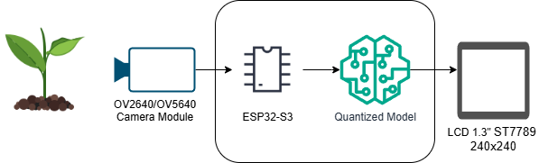
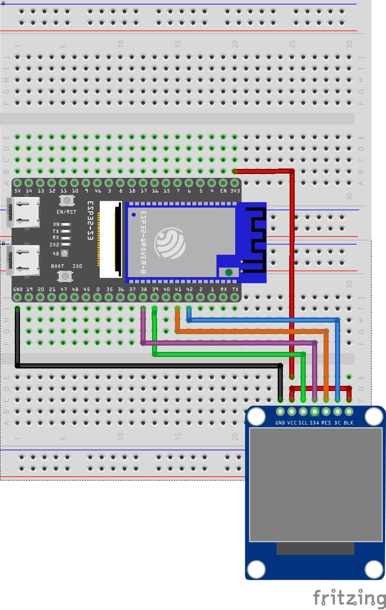
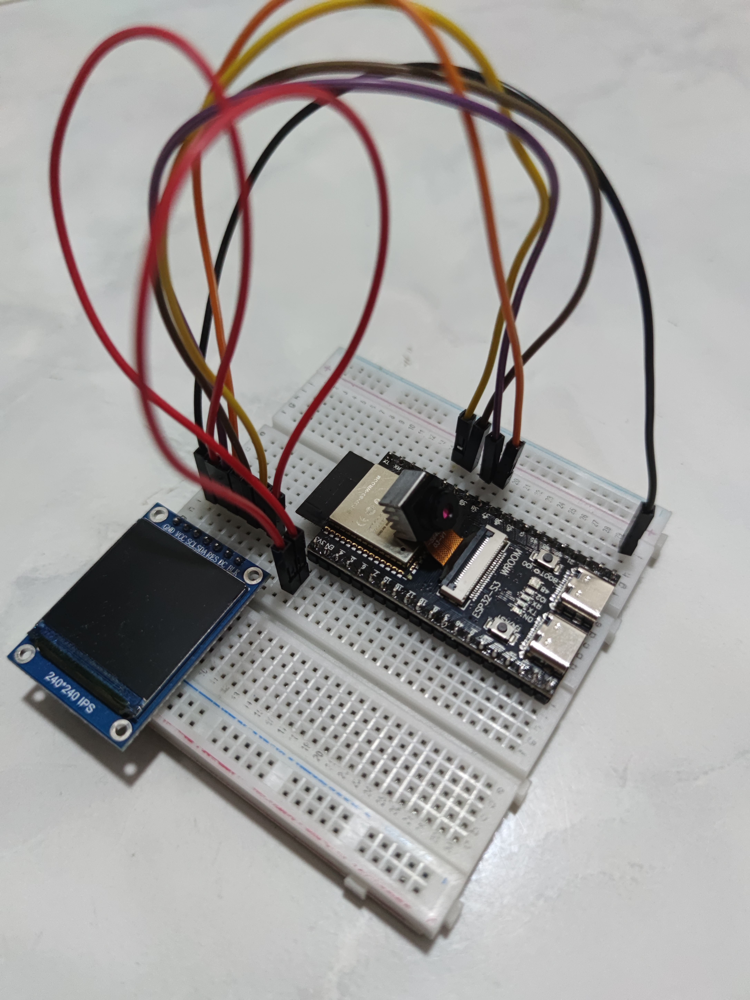
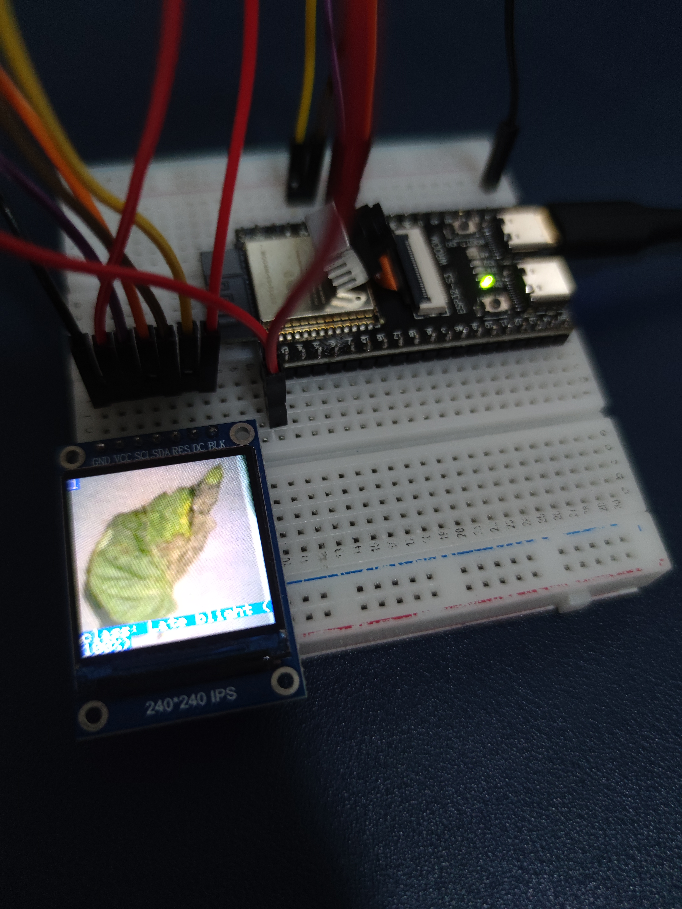

# ESP32-TinyML

TinyML deployment of a lightweight VGG model that identifies tomato leaf disease on an
**ESP32-S3-N16R8** microcontroller. Instead of feeding raw RGB pixels to the network, the
firmware computes a visible-band vegetation index (**VABC**) per pixel, normalizes it, and
runs a fully integer-quantized (INT8) TensorFlow Lite Micro model entirely on the device.

The result is shown on a 240×240 TFT display and printed to the serial monitor, with no
network connection or companion computer involved.

---

## Project background

This repository archives the code, model, and deployment assets of a Master's degree
project in Computer Science at **Bina Nusantara University**, titled:

> *Development of Lightweight Models using Vegetation Indices to Identify Tomato Leaf
> Disease Deployed on a Microcontroller*

The thesis is published in the university repository and is in progress for journal
publication.

Three lightweight models based on **ResNet**, **VGG**, and **InceptionV3** were built and
trained from scratch. All three went through pruning and quantization, but the **VGG-based
model** was selected for TinyML deployment because it performed better than the other two
candidates.

---

## Repository layout

```text
ESP32-TinyML/
├── firmware/esp32s3_cam/   Arduino sketch + quantized model header
├── models/                 trained checkpoint and INT8 TFLite model
├── notebooks/              training, quantization, and header conversion
└── docs/                   diagrams and prototype photos
```

| Path | Description |
| --- | --- |
| [`firmware/esp32s3_cam/esp32s3_cam.ino`](https://github.com/rhe-naldy/ESP32-TinyML/blob/main/firmware/esp32s3_cam/esp32s3_cam.ino) | ESP32-S3 firmware: camera capture, VABC computation, normalization, INT8 inference, TFT output |
| [`firmware/esp32s3_cam/vggnet_vabc_gznorm_aug_int8.h`](https://github.com/rhe-naldy/ESP32-TinyML/blob/main/firmware/esp32s3_cam/vggnet_vabc_gznorm_aug_int8.h) | The quantized model as a C byte array (`vggnet_model`), included by the firmware |
| [`models/quantized/vggnet_vabc_gznorm_aug_int8.tflite`](https://github.com/rhe-naldy/ESP32-TinyML/blob/main/models/quantized/vggnet_vabc_gznorm_aug_int8.tflite) | Standalone INT8 TFLite model (same weights as the header) |
| [`models/trained/vggnet_vabc_gznorm_aug_best.h5`](https://github.com/rhe-naldy/ESP32-TinyML/blob/main/models/trained/vggnet_vabc_gznorm_aug_best.h5) | Best Keras checkpoint saved during training |
| [`notebooks/01_train_vggnet_vabc_gznorm_aug.ipynb`](https://github.com/rhe-naldy/ESP32-TinyML/blob/main/notebooks/01_train_vggnet_vabc_gznorm_aug.ipynb) | Training notebook: data loading, VABC conversion, z-score normalization, model definition and training |
| [`notebooks/02_prune_quantize_vggnet_vabc_gznorm_aug_int8.ipynb`](https://github.com/rhe-naldy/ESP32-TinyML/blob/main/notebooks/02_prune_quantize_vggnet_vabc_gznorm_aug_int8.ipynb) | Quantization notebook: pruning strip, representative dataset, INT8 conversion and evaluation |
| [`notebooks/03_convert_tflite_to_header.ipynb`](https://github.com/rhe-naldy/ESP32-TinyML/blob/main/notebooks/03_convert_tflite_to_header.ipynb) | Header conversion notebook: inspects tensors/ops and converts the `.tflite` bytes into a C array |
| [`docs/system-architecture.png`](https://github.com/rhe-naldy/ESP32-TinyML/blob/main/docs/system-architecture.png) | System architecture diagram |
| [`docs/circuit.png`](https://github.com/rhe-naldy/ESP32-TinyML/blob/main/docs/circuit.png) | Wiring / circuit diagram |
| [`docs/prototype.jpg`](https://github.com/rhe-naldy/ESP32-TinyML/blob/main/docs/prototype.jpg) | Photo of the assembled prototype |
| [`docs/inference.jpg`](https://github.com/rhe-naldy/ESP32-TinyML/blob/main/docs/inference.jpg) | Photo of on-device inference |

### Naming convention

Files follow `<arch>_<index>_<norm>_<aug>[_<precision>]`:

| Token | Value used here | Meaning |
| --- | --- | --- |
| `<arch>` | `vggnet` | Lightweight VGG network, called **LI-VGGNet** in the thesis |
| `<index>` | `vabc` | Inputs preprocessed with the VABC vegetation index; NGRDI and TGI were the other indices evaluated |
| `<norm>` | `gznorm` | Global z-score normalization applied after the index |
| `<aug>` | `aug` | Trained on augmented data |
| `_best` | suffix | Best validation checkpoint |
| `_int8` | suffix | Fully integer INT8 quantized model |

Notebooks are numbered by pipeline stage: `01_train_…` builds and trains the model from
scratch, `02_prune_quantize_…` prunes and quantizes it, and
`03_convert_tflite_to_header.ipynb` exports the quantized model as a C header. The original
experiment files used bracketed tags — `[MODEL]`, `[Quant]`, `[VABC]`, `[GZNorm]`, `[INT8]`,
`[AUG]` — which map directly onto the tokens above.

---

## Model

A compact VGG-style network, implemented from scratch (not a pretrained backbone) and
trained on single-channel vegetation-index images.

In the thesis, the lightweight variants are written as `LI-<ModelName>`, where `LI` stands
for *lightweight* — so this network is referred to as **LI-VGGNet**. The repository uses the
shorter `vggnet` token in filenames to match the exported C symbol `vggnet_model`.

| Stage | Configuration |
| --- | --- |
| Input | 256 × 256 × 1 (VABC, z-score normalized) |
| Block 1 | Conv2D 16, 3×3 → BatchNorm → MaxPool 2×2 |
| Block 2 | Conv2D 16, 3×3 → BatchNorm → MaxPool 2×2 |
| Block 3 | Conv2D 32 ×2, 3×3 → BatchNorm → MaxPool 2×2 |
| Block 4 | Conv2D 64 ×2, 3×3 → BatchNorm → MaxPool 2×2 |
| Head | Global average pooling → Dense 64 → Dropout 0.5 → Dense 10 (softmax) |

**Training.** Adam (learning rate `1e-4`), categorical cross-entropy, batch size 16, up to
100 epochs, checkpointing on best validation categorical accuracy, fixed seed 42. The
augmented training split is used (`AUG`).

**Compression.** After pruning, the model is converted to a fully integer TFLite model with
`TFLITE_BUILTINS_INT8`; both input and output tensors are `int8`. A representative dataset
of leaf images is used for calibration. The exported `.tflite` is then converted to the C
array in `vggnet_vabc_gznorm_aug_int8.h`; the conversion routine is recorded in
`03_convert_tflite_to_header.ipynb`.

**Output classes (10):**

`Healthy` · `Early blight` · `Late blight` · `Bacterial spot` · `Leaf mold` ·
`Septoria leaf spot` · `Target spot` · `Mosaic virus` · `Yellow leaf curl virus` ·
`Spider mites`

---

## On-device pipeline

1. **Capture** — the OV2640 camera grabs a 240×240 frame (YUV422, converted to RGB888).
2. **Pad** — the frame is placed in the center of a 256×256 input tensor; the 8-pixel border
   is filled with a constant value derived from the VABC of blue.
3. **Vegetation index** — each pixel is converted to VABC:

   ```text
   VABC = (0.590 + 0.193) × (G − 0.095·R − 0.821·B)
   ```

4. **Normalize** — global z-score using the training-set statistics hard-coded in the
   firmware (`mean = 18.77009`, `stdev = 22.366663`).
5. **Quantize** — the normalized value is mapped to `int8` with the input tensor's scale and
   zero point.
6. **Infer** — the TFLite Micro interpreter runs the model from the tensor arena in PSRAM.
7. **Report** — the winning class and confidence are drawn on the TFT and written to the
   serial console.

The camera preview is shown for 15 seconds before each classification so the leaf can be
positioned, then the cycle repeats.

---

## Hardware

| Component | Detail |
| --- | --- |
| Microcontroller | ESP32-S3-N16R8 — 16 MB flash, 8 MB octal PSRAM |
| Camera | OV2640, ESP32-S3-EYE pin mapping (`CAMERA_MODEL_ESP32S3_EYE`) |
| Display | 240×240 SPI TFT driven by `TFT_eSPI` |
| Runtime | [`Chirale_TensorFlowLite`](https://github.com/Chirale/TensorFlowLite_ESP32) (TensorFlow Lite Micro port) |

The 8 MB PSRAM is what makes this deployment possible: the model needs roughly **2 MB of
PSRAM**, and the firmware reserves a **3 MB tensor arena** there. The model header itself is
about 576 KB and lives in flash.

---

## Performance

As reported for the prototype:

- Average runtime of approximately **12.1 seconds** per classification.
- Approximately **2 MB of PSRAM** used by the model, with a 3 MB arena reserved.
- All inference happens on-device; no Wi-Fi or host is required.

These numbers are hardware- and configuration-dependent — re-measure them if you change the
board, display, clock speed, or model.

---

## Getting started

### 1. Toolchain

- Arduino IDE 2.x with the Espressif **ESP32** board package installed.
- Libraries:
  - `Chirale_TensorFlowLite` (TensorFlow Lite Micro for ESP32)
  - `TFT_eSPI` — configure `User_Setup.h` for your display driver and pins
  - `esp32-camera` (ships with the ESP32 core)

### 2. Board settings

| Setting | Value |
| --- | --- |
| Board | ESP32S3 Dev Module |
| Flash size | 16 MB |
| PSRAM | OPI PSRAM |
| Partition scheme | A scheme with a large app partition (e.g. *Huge APP (3MB No OTA)*) |
| CPU frequency | 240 MHz |
| Upload speed | 921600 |

### 3. Build and flash

1. Open `firmware/esp32s3_cam/esp32s3_cam.ino`. The sketch folder already matches the `.ino`
   name, which Arduino requires.
2. The quantized model header, `vggnet_vabc_gznorm_aug_int8.h`, sits in the same folder and
   is included by the sketch.
3. Select the board settings above and upload.
4. Open the serial monitor at **115200 baud**.

### 4. Run

After reset, the firmware initializes PSRAM, camera, TFT, and the interpreter, then enters
the capture loop. Hold a tomato leaf in front of the camera during the 15-second preview;
the predicted class and confidence appear on the display and in the serial log. The loop
then pauses briefly and starts again.

---

## Reproducing the model

The three notebooks are the experiment record and should be read in order:

1. **Training** — `notebooks/01_train_vggnet_vabc_gznorm_aug.ipynb`: loads the dataset,
   converts images to VABC, applies global z-score normalization, defines the VGG-style
   network, trains it, and evaluates it with a confusion matrix and classification report.
2. **Quantization** — `notebooks/02_prune_quantize_vggnet_vabc_gznorm_aug_int8.ipynb`:
   loads the pruned model, strips pruning wrappers, builds the INT8 TFLite model with a
   representative dataset, and evaluates the quantized model's accuracy, precision, and
   recall.
3. **Header conversion** — `notebooks/03_convert_tflite_to_header.ipynb`: checks the
   quantized model's tensor types and estimated arena size, lists its operators, and
   converts the `.tflite` bytes into the C header included by the firmware.

The notebooks were written for a GPU-enabled Colab/Kaggle-style environment; file paths
inside them reflect that original workspace.

---

## Project images

### System architecture



### Circuit diagram



### Prototype



### Inference on device



---

## Citation

If you use this work, please cite the thesis:

```text
Rhenaldy. Development of Lightweight Models using Vegetation Indices to Identify
Tomato Leaf Disease Deployed on a Microcontroller. Master's thesis,
Bina Nusantara University.
```

## License

No license file is included in this repository. Please contact the author before reusing
the code, model, or images.
